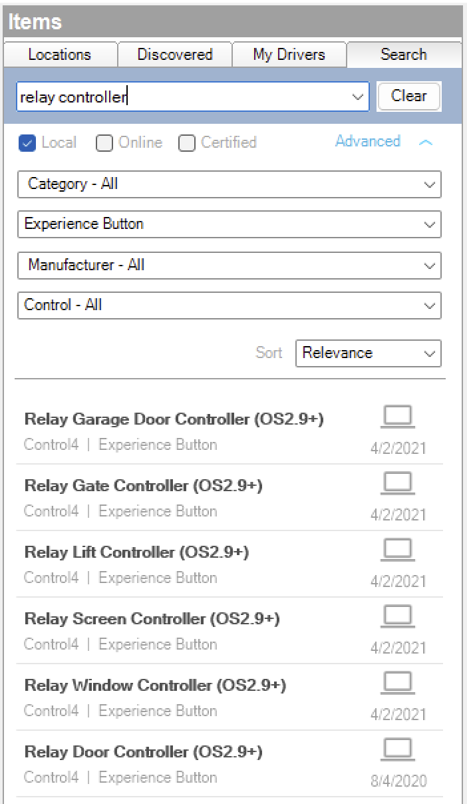
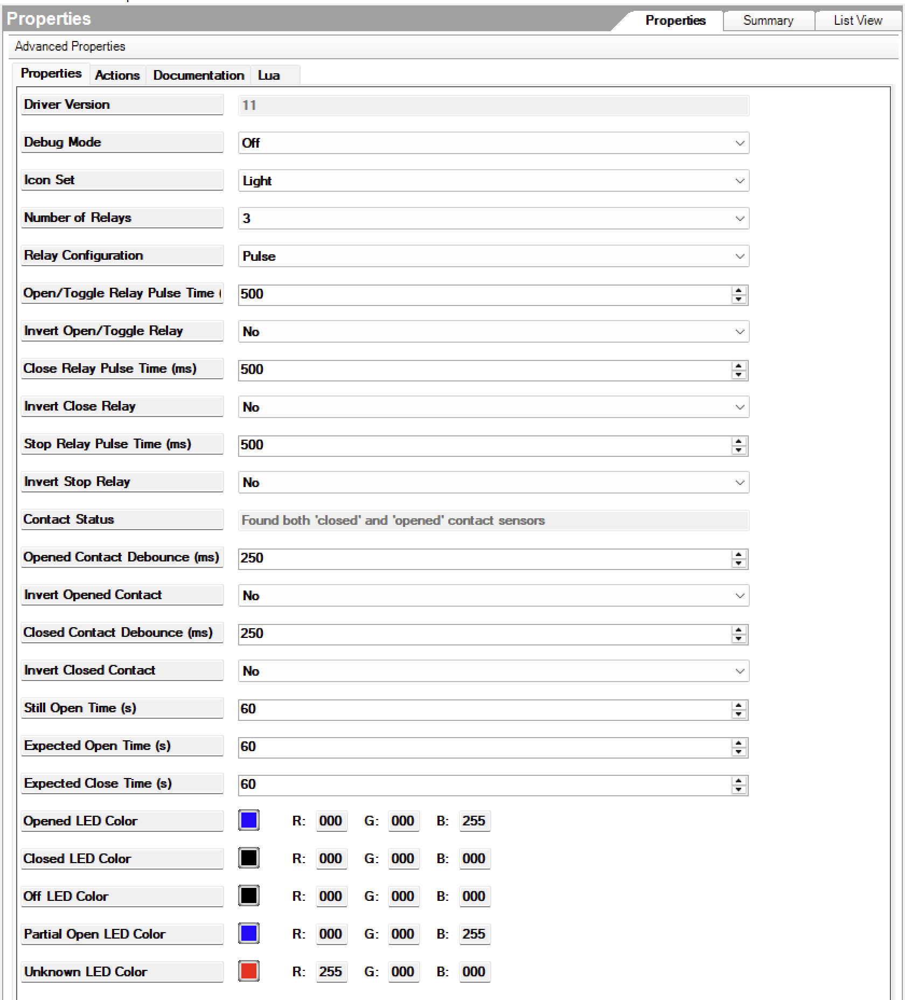
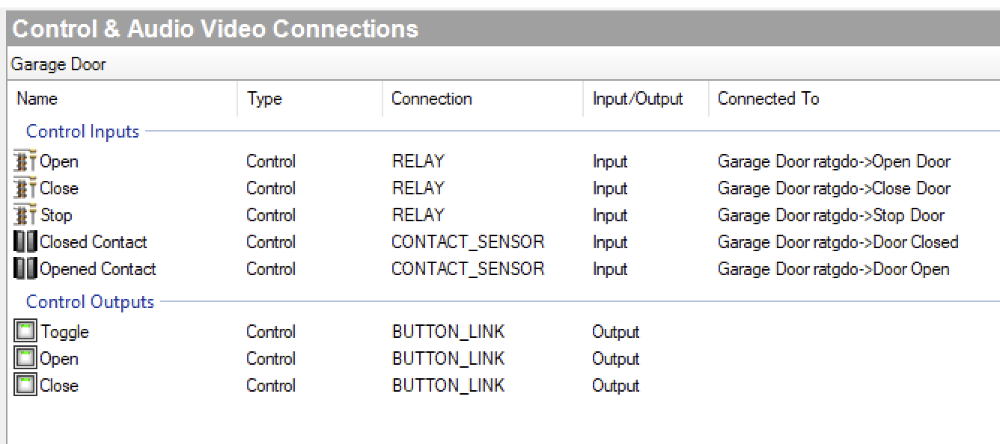

<!-- Copyright 2026 Finite Labs, LLC. All rights reserved. -->


______________________________________________________________________

# <span style="color:#17BCF2">Overview</span>

> DISCLAIMER: This software is neither affiliated with nor endorsed by either
> Control4 or ESPHome.

Integrate [ESPHome-based devices](https://devices.esphome.io) into Control4.
ESPHome is an open-source system that transforms common microcontrollers, like
ESP8266 and ESP32, into smart home devices through simple YAML configuration.
ESPHome devices can be set up, monitored, and controlled using a web browser,
Home Assistant, or other compatible platforms. This driver monitors and controls
ESPHome devices directly from your Control4 system.

# <span style="color:#17BCF2">Index</span>

<div style="font-size: small">

- [System Requirements](#system-requirements)
- [Features](#features)
- [Compatibility](#compatibility)
  - [Verified Devices](#verified-devices)
  - [Supported ESPHome Entities](#supported-esphome-entities)
- [Installer Setup](#installer-setup)
  - [Driver Installation](#driver-installation)
  - [Driver Setup](#driver-setup)
    - [Driver Properties](#driver-properties)
      - [Cloud Settings](#cloud-settings)
      - [Driver Settings](#driver-settings)
      - [Device Settings](#device-settings)
      - [Bluetooth Proxy Settings](#bluetooth-proxy-settings)
      - [Button LEDs](#button-leds)
      - [Device Info](#device-info)
    - [Driver Actions](#driver-actions)
  - [Programming Reference](#programming-reference)
- [Configuration Guides](#configuration-guides)
  - [Garage Door Configuration Guide](#garage-door-configuration-guide)
  - [Bluetooth Proxy Configuration Guide](#bluetooth-proxy-configuration-guide)
  - [Button LED Configuration Guide](#button-led-configuration-guide)
- [Support](#support)
- [Changelog](#changelog)

</div>

# <span style="color:#17BCF2">System Requirements</span>

- Control4 OS 3.3+

# <span style="color:#17BCF2">Features</span>

- Local network communication requiring no cloud services
- Real-time updates from all [supported entities](#supported-esphome-entities)
  exposed by the device
- Supports encrypted connections using the device encryption key
- Variable Programming Support

# <span style="color:#17BCF2">Compatibility</span>

## Verified Devices

This driver will generically work with any ESPHome device, but we have tested
extensively with the following devices:

- [ratgdo](https://ratcloud.llc)
- konnected Smart Garage Door Opener -
  [blaQ](https://konnected.io/products/smart-garage-door-opener-blaq-myq-alternative)
  / [White](https://konnected.io/products/smart-garage-door-opener)

Both are relay-based garage door controllers - see the
[Garage Door Configuration Guide](#garage-door-configuration-guide).

If you try this driver on a product listed above, and it works, let us know!

## Supported Bluetooth Devices

When used as a Bluetooth proxy, this driver supports the following BLE device
types through sub-drivers:

| Protocol    | Sub-Driver          | Example Devices                                      |
| ----------- | ------------------- | ---------------------------------------------------- |
| SwitchBot   | ESPHome SwitchBot   | Bot, Plug Mini, Relay Switch, Meter, Motion, Contact |
| BTHome      | ESPHome BTHome      | Shelly BLU Button/Door/Motion/H&T, DIY sensors       |
| Govee       | ESPHome Govee       | Temperature/humidity monitors, meat thermometers     |
| Yale/August | ESPHome Yale        | Yale and August smart locks                          |
| SereneScent | ESPHome SereneScent | Homedics SereneScent Diffuser                        |

See the individual sub-driver documentation for device-specific details.

## Supported ESPHome Entities

<div style="font-size: small">

| Entity Type         | Supported                     |
| ------------------- | ----------------------------- |
| Alarm Control Panel | ❌                            |
| API Noise           | ✅                            |
| Binary Sensor       | ✅                            |
| Bluetooth Proxy     | ✅                            |
| Button              | ✅                            |
| Camera              | ❌                            |
| Climate             | ✅                            |
| Cover               | ✅                            |
| Date                | ✅                            |
| Datetime            | ✅                            |
| Event               | ✅                            |
| Fan                 | ✅                            |
| Light               | ✅                            |
| Lock                | ✅                            |
| Media Player        | ❌                            |
| Number              | ✅                            |
| Select              | ✅                            |
| Sensor              | ✅                            |
| Siren               | ❌                            |
| Switch              | ✅                            |
| Text                | ✅                            |
| Text Sensor         | ✅                            |
| Time                | ✅                            |
| Update              | ❌                            |
| Valve               | ❌                            |
| Voice Assistant     | ❌[\*](#voice-assistant-note) |
| Water Heater        | ✅                            |

</div>

<a id="voice-assistant-note"></a>

> \* Voice Assistant requires a speech-to-text and intent processing pipeline
> (e.g. Home Assistant Assist). Control4 does not natively provide voice intent
> handling, so this entity type is not supported.

# <span style="color:#17BCF2">Installer Setup</span>

> ⚠️ Only a **_single_** driver instance is required per ESPHome device.
> Multiple instance of this driver connected to the same device will have
> unexpected behavior. However, you can have multiple instances of this driver
> connected to **_different_** ESPHome devices.

## Driver Installation

1. Download the latest `control4-esphome.zip` from
   [Github](https://github.com/finitelabs/control4-esphome/releases/latest).

1. Extract and
   [install](https://www.control4.com/help/c4/software/cpro/dealer-composer-help/content/composerpro_userguide/adding_drivers_manually.htm)
   all `.c4z` files.

1. Use the "Search" tab to find the "ESPHome" driver and add it to your project.

   > ⚠️ A **_single_** driver instance is required per ESPHome device.

1. Configure the [Device Settings](#device-settings) with the connection
   information.

1. After a few moments the [`Driver Status`](#driver-status-read-only) will
   display `Connected`. If the driver fails to connect, set the
   [`Log Mode`](#log-mode--off--print--log--print-and-log-) property to `Print`
   and re-set the [`IP Address`](#ip-address) field to reconnect. Then check the
   lua output window for more information.

1. Once connected, the driver will automatically create variables and connection
   bindings for each supported entity type.

1. To control climate, lights, fans, locks, and/or water heaters, use the
   "Search" tab to find the "ESPHome Climate", "ESPHome Light", "ESPHome Fan",
   and/or "ESPHome Lock" driver. For fans, choose the speed variant that matches
   your fan (e.g., "ESPHome Fan (3 Speed)"). Water heater entities use the
   "ESPHome Climate" driver. Add one driver instance for each exposed entity in
   your project. In the "Connections" tab, select the "ESPHome" driver and bind
   the entities to the newly added drivers.

## Driver Setup

### Driver Properties

#### Cloud Settings

##### Automatic Updates \[ Off | **_On_** \]

Enables or disables automatic driver updates from GitHub releases. Changing it
on any ESPHome driver changes it on all of them.

##### Update Channel \[ **_Production_** | Prerelease \]

Sets the update channel for which releases are considered during automatic
updates from GitHub releases. Changing it on any ESPHome driver changes it on
all of them.

#### Driver Settings

##### Driver Status (read-only)

Displays the current status of the driver.

##### Driver Version (read-only)

Displays the current version of the driver.

##### Log Level \[ 0 - Fatal | 1 - Error | 2 - Warning | **_3 - Info_** | 4 - Debug | 5 - Trace | 6 - Ultra \]

Sets the logging level. Default is `3 - Info`.

##### Log Mode \[ **_Off_** | Print | Log | Print and Log \]

Sets the logging mode. Default is `Off`.

##### Device Log Forwarding \[ **_Off_** | On \]

Forward ESPHome device logs to the driver's Lua output at the current Log Level.
Changing Log Level or disabling Log Mode will reconnect to apply the new
settings; a light keeps its level while it does.

#### Device Settings

##### IP Address

Sets the device IP address (e.g. `192.168.1.30`). Domain names are allowed as
long as they can be resolved to an accessible IP address by the controller.
HTTPS is not supported.

> ⚠️ If you are using an IP address, you should ensure it will not change by
> assigning a static IP or creating a DHCP reservation.

##### Port \[ 1 - 65535, default: **_6053_** \]

Sets the device port. The default port for ESPHome devices is `6053`.

##### Authentication Mode \[ **_None_** | Password | Encryption Key \]

Selects the authentication method for connecting to the ESPHome device.

- **None**: No authentication required.
- **Password**: Use a password for authentication (see below).
- **Encryption Key**: Use an encryption key for secure communication (see
  below).

> **Tip:** For ESPHome devices used primarily as Bluetooth proxies, consider
> configuring the firmware without API encryption. In busy BLE environments, the
> volume of proxy traffic combined with the controller's limited cryptographic
> performance can cause significant CPU load. BLE traffic is inherently
> over-the-air, and sensitive protocols (such as Yale/August lock commands) use
> their own end-to-end encryption between the driver and the device, making it
> safe to relay through an unencrypted proxy. To disable encryption, omit the
> `encryption` block from the ESPHome `api:` configuration and set
> Authentication Mode to `None`.

##### Password

Shown only if
[Authentication Mode](#authentication-mode--none--password--encryption-key-) is
set to `Password`. Sets the device password. This must match the password
configured on the ESPHome device.

##### Encryption Key

Shown only if
[Authentication Mode](#authentication-mode--none--password--encryption-key-) is
set to `Encryption Key`. Sets the device encryption key for secure
communication. This must match the encryption key configured on the ESPHome
device.

##### Use OpenSSL \[ **_Yes_** | No \]

Use OpenSSL for encryption. This should typically be left at the default value
of `Yes` for better performance and compatibility.

#### Bluetooth Proxy Settings

> The Bluetooth Proxy feature requires an ESP32 device with the
> `bluetooth_proxy` component configured in ESPHome. See the
> [ESPHome Bluetooth Proxy documentation](https://esphome.io/components/bluetooth_proxy.html)
> for firmware configuration.

##### Bluetooth Proxy Status (read-only)

Shows the current state of the Bluetooth proxy. The format is a pipe-separated
list of status components:

**Standalone Mode:** `Standalone Mode | Scanning (Passive) | 1/4 Active`

**Coordinator Mode:**
`Coordinator Mode | Scanning (Passive) | 0/3 Active | MAC Filter: 5 device(s)`

Components explained:

- **Mode** - "Standalone Mode" or "Coordinator Mode" depending on whether the
  driver is connected to a Bluetooth Coordinator
- **Scanner State** - Current state (Scanner Idle, Starting Scan, Scanning,
  Stopping Scan, Scanner Stopped or Scan Failed) and mode (Passive or Active)
- **Connection Slots** - Shows "used/total Active" slots (e.g., "1/4 Active"
  means 1 slot in use out of 4 available). Passive devices use no slot, and a
  device that connects only briefly frees its slot after each exchange. If you
  select more active devices than available slots, "(Oversubscribed)" is
  appended (see [Oversubscription](#oversubscription))
- **MAC Filter** - (Coordinator mode only) Shows how many device MACs are being
  filtered for, or "none" if forwarding all advertisements
- **Not Recovering - Power Cycle Device** - The proxy is wedged and only a
  restart of the ESP32 will clear it: the scanner has stopped receiving
  advertisements and the driver cannot restart it, or a device the proxy still
  holds connected has stopped answering. Bound devices report "Bluetooth proxy
  needs a restart". Press the device's Restart button or power cycle it, or let
  [Restart Bluetooth Proxy When Stuck](#restart-bluetooth-proxy-when-stuck) do
  it

##### Bluetooth Proxy Capabilities (read-only)

Displays a comma-separated list of capabilities supported by this ESPHome
Bluetooth proxy:

- **Scan** - Can receive BLE advertisements (passive scanning)
- **Connect** - Can establish GATT connections to devices (active connections)
- **Cache** - Caches GATT service data remotely
- **Pair** - Can pair with devices requiring authentication
- **Raw** - Can receive raw advertisement data

##### Select Bluetooth Devices

> Only visible in **Standalone Mode** (hidden when connected to a Bluetooth
> Coordinator, as device selection is done there instead).

A dropdown list showing discovered BLE devices. Select "Refresh List" to start a
new scan.

**During scanning:**

- The dropdown displays "-- Scanning..." while the scan is in progress
- Select "-- Stop Scan" to stop early and keep newly discovered devices
- Select "-- Abort Scan" to stop early and discard newly discovered devices
- When complete, the dropdown repopulates with discovered devices

**Device list shows:**

- MAC Address
- Device Name (if available)
- Device Type (BTHome, SwitchBot, Govee, etc.)
- Connection Type (Active/Passive)

After selecting a device, a connection binding is automatically created for the
appropriate sub-driver.

> **Tip:** Some BLE devices (buttons, sensors with long advertisement intervals)
> may be in sleep mode. Wake them by pressing buttons, triggering motion
> sensors, or opening/closing contact sensors during the scan to ensure they
> appear in the device list.

##### Bluetooth Scan Duration \[ 5 - 60, default: **_30_** \]

> Only visible in **Standalone Mode**.

Sets how long (in seconds) to scan for BLE devices when refreshing the device
list. Longer scans may discover more devices with long advertisement intervals.

##### Bluetooth Proxy Room

> Only visible in **Coordinator Mode** (when connected to a Bluetooth
> Coordinator).

Sets the room where this Bluetooth proxy is physically located. This is used for
presence tracking to determine which room a device is in based on signal
strength.

##### Minimum Room RSSI Override (dBm) \[ -100 - -40, default: **_-100_** \]

> Only visible in **Coordinator Mode** (when connected to a Bluetooth
> Coordinator).

Overrides the coordinator's global "Minimum Room RSSI" setting for this proxy's
room. Use this when a room has different size or characteristics than others.

- **-100 (default)** - Use the coordinator's global setting
- **-85** - More permissive; allow detection from further away (large rooms)
- **-60** - More restrictive; require closer proximity (small rooms)

**Examples:**

- Large living room: Set to `-85` to allow detection from further away
- Small bathroom: Set to `-60` to require closer proximity
- Leave at `-100` to use the coordinator's global setting

> **Note:** Only affects room assignment for this proxy. The value is sent to
> the Bluetooth Coordinator when this proxy connects or when the setting
> changes.

##### Restart Bluetooth Proxy When Stuck

> Only visible when the ESPHome device has a `restart` button with its default
> icon.

The restart button to press when the proxy is wedged (see
[Bluetooth Proxy Status](#bluetooth-proxy-status-read-only)): its scanner has
been stuck for about 15 minutes, or a device it holds connected has failed
service discovery three times in a row. The button is pressed at most once every
6 hours.

- **Off (default)** - Only report the condition in Bluetooth Proxy Status
- **_button name_** - Press this button

Only buttons that report the `restart` device class, the config entity category
and the `mdi:restart` icon are offered, so ESPHome's Safe Mode and Factory Reset
buttons never are. A Restart button whose icon the YAML overrides is not offered
either.

#### Button LEDs

> Only visible when the device has both event entities and light entities.

An event bound to a load acts as a keypad button. These properties choose which
of the device's lights is that button's LED, which then shows the load the way a
Control4 keypad lights its buttons. See the
[Button LED Configuration Guide](#button-led-configuration-guide).

##### Configure Button LED

Lists each event entity, with its LED when one is chosen (e.g.,
`Gang 3 Paddle Event -> Gang 3 LED`). Select one to choose its LED below.

##### Button LED

The light that is the selected button's LED, or **(None)** to leave the light
alone. A button and light that are alone together on an ESPHome sub-device are
paired automatically.

#### Device Info

##### Name (read-only)

Displays the name of the connected ESPHome device.

##### Model (read-only)

Displays the model of the connected ESPHome device.

##### Manufacturer (read-only)

Displays the manufacturer of the connected ESPHome device.

##### MAC Address (read-only)

Displays the MAC address of the connected ESPHome device.

##### Firmware Version (read-only)

Displays the firmware version of the connected ESPHome device.

### Driver Actions

#### Update Drivers

Trigger the driver to update from the latest release on GitHub, regardless of
the current version.

#### Reset Driver

> ⚠️ This will remove all connection bindings and delete the variables and
> events, along with any programming on them.

Resets the driver to its initial state, removing all dynamically created
connections, variables and events. It forgets each button's LED light and the
Bluetooth proxy's restart button, and returns the settings to their defaults.
The device's address and login stay. The update settings stay as they are too,
since every ESPHome item shares them. This is useful if you change the connected
ESPHome device or there are stale connections or variables.

**Parameters:**

- **Are You Sure?** \[ **_No_** | Yes \] - Confirmation to reset the driver.

## Programming Reference

Once connected, the driver automatically creates variables and bindings for each
supported ESPHome entity. Use this reference for Control4 programming.

### Driver Variables

In addition to per-entity variables, the driver publishes the following
device-level variables. `Connected` tracks the live connection; the rest mirror
the matching read-only Device Info properties.

| Variable     | Type   | Description                                    |
| ------------ | ------ | ---------------------------------------------- |
| Connected    | BOOL   | True while the driver is talking to the device |
| Name         | STRING | Friendly name reported by the ESPHome device   |
| Model        | STRING | Device model string reported by ESPHome        |
| Manufacturer | STRING | Manufacturer string reported by ESPHome        |
| MAC Address  | STRING | ESPHome device MAC address                     |

> **Tip:** Every sub-driver publishes its own `Connected` variable too, tracking
> the entity it is bound to. Use it in Programming to drive a custom Navigator
> element, send a notification, or trigger anything else when a device drops
> off. Thermostats, lights and fans additionally report their connection state
> to their proxy, so Navigator greys them out on its own.

### Variables by Entity Type

| Entity Type   | Variable Name       | Type   | Notes                                      |
| ------------- | ------------------- | ------ | ------------------------------------------ |
| Binary Sensor | `{name} State`      | BOOL   | "1" = triggered, "0" = clear               |
| Button        | (none)              | -      | Use "Press Button" command (see below)     |
| Climate       | (none)              | -      | State via Thermostat proxy                 |
| Cover         | `{name} State`      | STRING | "open", "closed", "opening", "closing"     |
| Date          | `{name}`            | STRING | Writable, formatted as YYYY-MM-DD          |
| Datetime      | `{name}`            | STRING | Writable, formatted as YYYY-MM-DD HH:MM:SS |
| Event         | `{name} Last Event` | STRING | Last event type (e.g., "single_press")     |
| Event         | `{name} LED`        | BOOL   | "1" = the button's linked load is lit      |
| Fan           | (none)              | -      | State via Fan proxy                        |
| Light         | (none)              | -      | State via Light proxy                      |
| Lock          | (none)              | -      | State via Lock proxy                       |
| Number        | `{name}`            | NUMBER | Writable, 1 decimal precision              |
| Select        | `{name}`            | STRING | Writable, current option                   |
| Sensor        | `{name}`            | NUMBER | Read-only, 1 decimal precision             |
| Switch        | `{name} State`      | BOOL   | "1" = on, "0" = off (writable)             |
| Text          | `{name}`            | STRING | Writable                                   |
| Text Sensor   | `{name}`            | STRING | Read-only                                  |
| Time          | `{name}`            | STRING | Writable, formatted as HH:MM:SS            |
| Water Heater  | (none)              | -      | State via Thermostat proxy                 |

> **Note:** `{name}` is the entity's ESPHome name. An entity with no name uses
> its device's name. Entities of different types may share a name. When two of
> one type share a name, or two would write the same variable, the others are
> told apart by their sub-device or their type (e.g., "Kitchen Temperature" or
> "Status (Sensor)").

A writable variable shows the device's value. A value set while the device is
offline, or a date or time in another format, goes back to the device's value.

### Bindings by Entity Type

| Entity Type   | Binding Class                   | Purpose                                                           |
| ------------- | ------------------------------- | ----------------------------------------------------------------- |
| Binary Sensor | `CONTACT_SENSOR`                | Integrates with Contact Sensor proxy                              |
| Switch        | `RELAY`                         | Control via Relay proxy                                           |
| Cover         | `CONTACT_SENSOR`                | Open/closed state contacts                                        |
| Cover         | `RELAY`                         | Open/close/stop control relays                                    |
| Button        | `BUTTON_LINK`                   | Allows other devices to trigger button                            |
| Event         | `BUTTON_LINK`                   | One connection per event type, triggers other devices             |
| Climate       | `ESPHOME_CLIMATE`               | Bind to ESPHome Climate sub-driver [\*\*](#climate-services-note) |
| Fan           | `ESPHOME_FAN_N_SPEED[_REVERSE]` | Bind to ESPHome Fan sub-driver                                    |
| Light         | `ESPHOME_LIGHT`                 | Bind to ESPHome Light sub-driver                                  |
| Lock          | `ESPHOME_LOCK`                  | Bind to ESPHome Lock sub-driver                                   |
| Water Heater  | `ESPHOME_CLIMATE`               | Bind to ESPHome Climate sub-driver                                |

> **Note:** Sensor, Number, Select, Text, Text Sensor, Date, Time and Datetime
> entities do not create bindings. They expose data only through variables and
> events.

> **Note:** The Button and Event binding classes are the same but point opposite
> ways. A Button binding lets another device press the ESPHome button; an Event
> binding lets the ESPHome device act as a keypad button and drive a load.

> **Note:** Water Heater entities share the `ESPHOME_CLIMATE` binding class and
> are controlled via the ESPHome Climate sub-driver. Device modes (such as Eco,
> Heat Pump, Gas) are exposed as presets.

<a id="climate-services-note"></a>

> \*\* **Climate remote sensor:** The Climate sub-driver supports using an
> external Control4 temperature sensor instead of the climate device's built-in
> sensor. This feature requires the ESPHome device YAML to define user-defined
> API services (e.g., `set_remote_temperature` and `use_internal_temperature`).
> See the ESPHome Climate sub-driver documentation for full details and YAML
> examples.

### Bluetooth Proxy Bindings

When the connected ESPHome device exposes a Bluetooth proxy, additional dynamic
bindings are created separately from the entity bindings above:

| Source                      | Binding Class         | Purpose                                                  |
| --------------------------- | --------------------- | -------------------------------------------------------- |
| Bluetooth Coordinator link  | `ESPHOME_BLUETOOTH`   | Connects the ESPHome driver to the Bluetooth Coordinator |
| Selected BTHome device      | `ESPHOME_BTHOME`      | Bind to ESPHome BTHome sub-driver                        |
| Selected Govee device       | `ESPHOME_GOVEE`       | Bind to ESPHome Govee sub-driver                         |
| Selected SereneScent device | `ESPHOME_SERENESCENT` | Bind to ESPHome SereneScent sub-driver                   |
| Selected SwitchBot device   | `ESPHOME_SWITCHBOT`   | Bind to ESPHome SwitchBot sub-driver                     |
| Selected Yale/August lock   | `ESPHOME_YALE`        | Bind to ESPHome Yale sub-driver                          |

> **Note:** Per-device Bluetooth bindings are created automatically when a
> device is chosen via the `Select Bluetooth Devices` property (standalone mode)
> or via the Bluetooth Coordinator's device selector (coordinator mode). Binding
> display names include the device MAC address suffix for easy identification.

### Events by Entity Type

| Entity Type | Event Name             | Description                                 |
| ----------- | ---------------------- | ------------------------------------------- |
| Event       | `{name}: {event_type}` | One C4 event per event type for programming |

> **Note:** Event entities are stateless triggers (button presses, gestures,
> doorbell rings). Each discovered event type creates a Control4 event that can
> be used in programming, plus a `BUTTON_LINK` connection named
> `{name} {event_type}` that can be bound straight to a load. The
> `{name} Last Event` variable tracks the most recent event type, and
> `{name} LED` whether the button's linked load is lit (see
> [Button LEDs](#button-leds)).

### Commands

| Command      | Parameters     | Description                                  |
| ------------ | -------------- | -------------------------------------------- |
| Press Button | Button         | Triggers an ESPHome button entity by name    |
| Set Select   | Select, Option | Sets a select entity to the specified option |

> **Note:** The Button parameter is a dynamic list populated with discovered
> ESPHome button entities. The Select and Option parameters are dynamic lists
> populated with discovered ESPHome select entities and their available options.

# <span style="display:none">Configuration Guides</span>

# <span style="color:#17BCF2">Garage Door Configuration Guide</span>

This guide provides instructions for configuring the ESPHome driver for garage
door control via relays in Control4 Composer Pro. It applies to any ESPHome
device that exposes a cover entity, including ratgdo and konnected's Smart
Garage Door Opener.

The driver names the relay and contact bindings after the cover entity, so the
labels in Composer Pro depend on the device. ratgdo names its cover "Door", so
you will see "Open Door" and "Door Closed". konnected defaults to "Garage Door".
Substitute your device's cover name throughout this guide.

## Add Relay Controller Driver

Add the desired relay controller driver to your Control4 project in Composer
Pro.



## Relay Controller Properties

The device exposes a "Cover" entity in ESPHome, which maps to the relay
controller functionality in Control4.

### Number of Relays

The driver creates separate relays for opening and closing the garage door. In
Composer Pro, you should configure the relay settings as follows:

- Set to **2 Relays** (Open/Close) or **3 Relays** (Open/Close/Stop)
  - The stop relay is only created when the device reports support for it. If
    you are not sure, look at the connections in Composer Pro to see if the
    "Stop" relay is available, and configure for 3 relays if it is.

### Relay Configuration

- Set to **Pulse**
  - These devices use momentary pulses to trigger the garage door opener,
    similar to a wall button press

### Pulse Time

- Set all relay pulse times to **500** (default)
  - This is the duration the relay will be activated

### Invert Relay

- Set all invert relay properties to **No** (default)

### Contact Debounce

- Set all contact debounce times to **250** (default)
  - This helps prevent false flapping of the garage door state sensors

### Invert Contact

- Set all invert contact properties to **No** (default)

### Example Properties

For reference, here is an example of the relay controller properties in Composer
Pro:



## Relay Controller Connections

### Relays

Where `{cover}` is the name of the device's cover entity ("Door" on ratgdo,
"Garage Door" on konnected):

- **Open**: Connect to the "Open {cover}" relay
- **Close**: Connect to the "Close {cover}" relay
- **Stop**: Connect to the "Stop {cover}" relay, if available

### Contact Sensors

- **Closed Contact**: Connect to the "{cover} Closed" contact
- **Opened Contact**: Connect to the "{cover} Open" contact

### Example Connections

For reference, here is an example of how the connections should look in Composer
Pro:



## Programming

You can create programming in Control4 to:

- Open/close the garage door based on events
- Monitor the garage door state
- Set up notifications for garage door status changes
- Create custom buttons on touchscreens and remotes

### Example: Creating a "Still Open" Alert

Using the "Still Open Time" property from the relay controller driver:

1. Set the "Still Open Time" to your desired duration (e.g., 10 minutes)
1. Create a programming rule that triggers when the "Still Open" event fires
1. Add actions to send notifications or perform other tasks

## Additional Entities

Depending on your device, firmware, and its capabilities, there may be
additional entities exposed by the ESPHome driver. These can come as additional
connections or driver variables.

Please refer to your device's documentation for more information on specific
entities:

- ratgdo: https://ratgdo.github.io/esphome-ratgdo/webui_documentation.html
- konnected:
  https://support.konnected.io/esphome-on-the-konnected-garage-door-opener

# <span style="color:#17BCF2">Bluetooth Proxy Configuration Guide</span>

This guide explains how to use the ESPHome Bluetooth Proxy feature to integrate
BLE devices into Control4.

## Prerequisites

- ESP32 device with ESPHome firmware and `bluetooth_proxy` component enabled
- BLE devices within range of the ESP32

**Recommended Hardware:**

The following POE-powered Bluetooth proxies are excellent choices with 4 active
connection slots:

- [Seeed Studio XIAO W5500 Ethernet Adapter](https://www.seeedstudio.com/XIAO-W5500-Ethernet-Adapter-p-6472.html?sensecap_affiliate=sikqXSu&referring_service=link)
- [Olimex ESP32-POE](https://www.olimex.com/Products/IoT/ESP32/ESP32-POE/open-source-hardware)
  or
  [ESP32-POE-ISO](https://www.olimex.com/Products/IoT/ESP32/ESP32-POE-ISO/open-source-hardware)

_Some hardware links above are affiliate links. Purchases through them help
support driver development at no extra cost to you._

**Firmware Installation:**

- **Quick Start:** Use [web.esphome.io](https://web.esphome.io) for one-click
  firmware installation directly in your browser - no YAML configuration needed.
- **Advanced:** For more control over settings, create a custom YAML
  configuration. See the
  [ESPHome Bluetooth Proxy documentation](https://esphome.io/components/bluetooth_proxy.html)
  for configuration options.

## Understanding Connection Types

BLE devices use one of two connection modes:

### Passive Mode (No Slot Required)

Passive devices broadcast their data in advertisements. The proxy listens
without establishing a connection. These devices include:

- **Shelly BLU devices** - Button, Door/Window, Motion, H&T sensors (native
  BTHome support)
- **BTHome sensors** - Temperature, humidity, motion, door sensors
- **Govee sensors** - Temperature/humidity monitors, meat thermometers
- **SwitchBot sensors** - Meters, motion sensors, contact sensors, water leak

**Advantage:** Unlimited passive devices can be monitored simultaneously.

### Active Mode (Uses Connection Slot)

Active devices require a GATT connection to send commands. The ESP32 has limited
connection slots (typically 3-4). These devices include:

- **SwitchBot Bot** - Requires connection to send press/on/off commands
- **SwitchBot Switch** - Plug Mini, Relay switches (encrypted commands)
- **Yale/August Locks** - Requires connection for encrypted lock/unlock commands
- **Homedics SereneScent** - Requires connection for commands and status reads

### Oversubscription

You can select more active devices than available connection slots. This is
called **oversubscription** and works well when devices only need brief
connections to exchange data (e.g., sending a command to a SwitchBot Bot). The
device connects, sends the command, and immediately frees the slot.

Oversubscription becomes problematic when multiple devices need simultaneous
connections. If all slots are in use, commands to additional devices will queue
and retry until a slot becomes available.

> **Tip:** If you see "Allocation failed" errors in the logs, you have too many
> concurrent active connections. Consider reducing the number of active devices
> or adding another proxy.

## Step-by-Step Setup

1. **Add the ESPHome driver** and configure it to connect to your ESP32 device.

1. **Verify Bluetooth Proxy Status** shows "Scanning" with free slots.

1. **Scan for devices:**

   - Set "Bluetooth Scan Duration" (30 seconds recommended)
   - Select "Refresh List" from the "Select Bluetooth Devices" dropdown
   - Wait for the scan to complete

1. **Select a discovered device** from the dropdown. A connection will be
   automatically created.

1. **Add the appropriate sub-driver:**

   - Search for the driver matching your device type (e.g., "ESPHome BTHome")
   - Add it to your project

1. **Bind the sub-driver** to the connection created in step 4.

1. **Configure the sub-driver** properties as needed.

## Supported Device Types

| Device Protocol | Sub-Driver          | Connection     |
| --------------- | ------------------- | -------------- |
| BTHome          | ESPHome BTHome      | Passive        |
| Govee           | ESPHome Govee       | Passive        |
| SwitchBot       | ESPHome SwitchBot   | Active/Passive |
| Yale/August     | ESPHome Yale        | Active         |
| SereneScent     | ESPHome SereneScent | Active         |

## Performance Considerations

### Device Limits

The ESP32 Bluetooth proxy has practical limits on device capacity:

| Connection Type    | Recommended Limit | Notes                               |
| ------------------ | ----------------- | ----------------------------------- |
| Passive devices    | 20-30             | Sensors broadcasting advertisements |
| Active connections | 3-5               | Devices requiring GATT connections  |

Exceeding these limits may cause:

- Missed advertisements from passive devices
- "Allocation failed" errors for active connections
- Delayed or failed commands to active devices

> **Warning:** If you see "Too many BLE events to process" in the logs, the
> proxy is overwhelmed. Reduce the number of tracked devices or add another
> proxy.

### Busy BLE Environments

In environments with many BLE devices (smart home hubs, fitness equipment,
wireless speakers, neighbors' devices), performance may degrade:

- **2.4 GHz congestion** - BLE and WiFi share spectrum; heavy WiFi traffic
  affects BLE reception
- **Advertisement flooding** - Many devices broadcasting simultaneously can
  overwhelm the scanner
- **Interference sources** - Microwaves, USB 3.0 devices, and poorly shielded
  electronics cause interference

**Mitigation strategies:**

1. Use Ethernet-connected ESP32 boards (Olimex ESP32-POE) to avoid WiFi/BLE
   contention
1. Position proxies away from WiFi routers (at least 2-3 meters)
1. Use the Bluetooth Coordinator to distribute load across multiple proxies
1. Reduce scan duration if not actively discovering new devices

### Proxy Placement Tips

For optimal BLE reception:

- **Height matters** - Place at chest height or higher, not on the floor
- **Avoid metal** - Keep away from refrigerators, filing cabinets, and metal
  shelving (metal causes reflections and unstable signals)
- **Avoid enclosed spaces** - Don't place inside cabinets or behind furniture
- **Distance from electronics** - Keep 2-3 meters from routers, switches, and
  other network equipment

**Coverage expectations:**

| Environment          | Typical Range           |
| -------------------- | ----------------------- |
| Open indoor space    | 10-15 meters (30-50 ft) |
| Through 1-2 walls    | 5-10 meters (15-30 ft)  |
| Concrete/brick walls | 3-5 meters (10-15 ft)   |

## Bluetooth Coordinator Setup

For advanced setups with **multiple ESPHome Bluetooth proxies**, use the
**ESPHome Bluetooth Coordinator** driver to aggregate them. The coordinator
provides:

- **RSSI-based routing** - Commands are routed to the proxy with the best signal
  strength for each BLE device
- **Automatic failover** - If a connection fails, the coordinator retries
  through alternate proxies
- **Room-level presence tracking** - Track which room a BLE device (like a
  phone) is in based on signal strength from each proxy

> **Note:** Apple devices (iPhone, iPad, Apple Watch) and Android devices with
> MAC randomization enabled cannot be tracked for presence. Use dedicated BLE
> beacons or devices with static MAC addresses instead.

### When to Use the Coordinator

| Setup                    | Recommendation              |
| ------------------------ | --------------------------- |
| Single ESP32 proxy       | Use ESPHome driver directly |
| Multiple proxies         | Use Bluetooth Coordinator   |
| Want presence tracking   | Use Bluetooth Coordinator   |
| Want failover/redundancy | Use Bluetooth Coordinator   |

### Coordinator Setup Steps

1. **Add the Bluetooth Coordinator driver** to your project
1. **Connect your ESPHome drivers** to the coordinator's proxy bindings
   (Connections tab)
1. **Set the "Bluetooth Proxy Room" property** on each ESPHome driver to
   indicate where that proxy is physically located
1. **Select devices** via the coordinator's "Select Bluetooth Devices" property
1. **For presence tracking**, select devices via "Select Presence Devices"

When an ESPHome driver is connected to the coordinator:

- The "Select Bluetooth Devices" property is hidden (selection is done in the
  coordinator)
- The "Bluetooth Proxy Room" property becomes visible for presence tracking
  configuration

See the **ESPHome Bluetooth Coordinator** driver documentation for full details
on presence tracking settings and events.

# <span style="color:#17BCF2">Button LED Configuration Guide</span>

An ESPHome event bound to a load acts as a Control4 keypad button: pressing it
drives the load. With a Button LED, the device also shows the load's state on
one of its own lights, as a keypad lights its button.

## Requirements

The device needs:

- **The button as an `event` entity.** Only events create button connections. A
  button exposed only as a `binary_sensor` appears as a contact sensor instead.
- **The LED as a `light` entity.** Any light platform works: `binary` or
  `monochromatic` lights turn on and off, and `rgb` (or any light that can show
  a color) shows the load's colors. The `status_led:` component is not a light
  entity; use `light: - platform: status_led` instead.

No other YAML is needed.

```yaml
binary_sensor:
  - platform: gpio
    pin: GPIO0
    id: button_1
    internal: true
    on_multi_click:
      - timing: [ON for at most 1s, OFF for at least 0.5s]
        then:
          - event.trigger: { id: button_1_event, event_type: press }
      - timing: [ON for at least 1s]
        then:
          - event.trigger: { id: button_1_event, event_type: long_press }

event:
  - platform: template
    id: button_1_event
    name: "Button 1"
    event_types: [press, long_press]

output:
  - platform: gpio
    pin: GPIO2
    id: led_1_out

light:
  - platform: binary
    name: "Button 1 LED"
    output: led_1_out
```

To pair them without any setup in Composer, put the button and its LED alone
together on an ESPHome sub-device (ESPHome 2025.7 or later):

```yaml
esphome:
  devices:
    - id: button_1
      name: "Button 1"
event:
  - platform: template
    id: button_1_event
    name: "Button"
    device_id: button_1
    event_types: [press, long_press]
light:
  - platform: binary
    name: "LED"
    device_id: button_1
    output: led_1_out
```

On a display, an LVGL button can fire the event, and a template output can
recolor it instead of driving a pin. Fire press from `on_short_click`, not
`on_click`: LVGL also sends a click after a long press, so `on_click` would fire
press on every hold. Make the on color clearly brighter than the off color;
close shades look the same on a panel.

```yaml
lvgl:
  pages:
    - id: main_page
      widgets:
        - button:
            id: lv_button_2
            on_short_click:
              - event.trigger: { id: button_2_event, event_type: press }
            on_long_press:
              - event.trigger: { id: button_2_event, event_type: long_press }
            widgets:
              - label:
                  text: "Button 2"
event:
  - platform: template
    id: button_2_event
    name: "Button 2"
    event_types: [press, long_press]
output:
  - platform: template
    id: button_2_led_out
    type: binary
    write_action:
      - lvgl.widget.update:
          id: lv_button_2
          bg_color: !lambda 'return lv_color_hex(state ? 0xE0A82E : 0x20252B);'
light:
  - platform: binary
    name: "Button 2 LED"
    output: button_2_led_out
```

## Setup

1. Bind the event's `{name} {event_type}` connection to the load, as you would a
   keypad button. Bind it to a light's Toggle, On or Off button link to have the
   button toggle, turn on or turn off the light.
1. In the ESPHome driver's properties, select the button under **Configure
   Button LED** and its light under **Button LED**. A pair already made from a
   sub-device shows next to the button.

## How the LED Behaves

- A light that can show a color shows the load's on color while the load is on
  and its off color while it is off; black is dark. Set the colors on the load,
  as for any keypad button linked to it: for a light, under its **Button and
  Button Connection Status LED Colors**. A load that sends no colors lights the
  LED blue. A light that cannot show a color is on while the load is on and off
  while it is off.
- When the link is bound, when the device connects and after the driver reloads,
  the driver asks the load for its state, so the LED is right without waiting
  for the load to change.
- A button has one LED but a connection for each event type. The LED follows the
  first event type with a load bound, in the order the device declares them
  (normally press). Unbinding it hands the LED to the next one; with none left
  it goes dark.

> **Note:** Leave a light used as a button LED unbound from an ESPHome Light
> driver. Both would command it, and the button's load would win each time it
> changes.

# <span style="color:#17BCF2">Support</span>

If you have any questions or issues integrating this driver with Control4, you
can file an issue on GitHub:

https://github.com/finitelabs/control4-esphome/issues/new

<a href="https://www.buymeacoffee.com/derek.miller" target="_blank"></a>

# <span style="color:#17BCF2">Changelog</span>

<!--
Template for a new release entry (copy below the heading, fill in, uncomment):

## v[Version] - YYYY-MM-DD

### Added
- Added

### Fixed
- Fixed

### Changed
- Changed

### Removed
- Removed
-->

## Unreleased

### Fixed

- Fixed a Yale lock in Persistent mode never reconnecting after its reconnect
  attempts ran out. It now tries again when the lock is heard, at most every
  five minutes.
- Fixed a Yale lock still showing online after its reconnect attempts ran out or
  its connection to the ESPHome driver or Bluetooth Coordinator was removed
- Fixed a Yale lock in Poll mode with no Offline Key connecting to the lock at
  every poll. It now waits for a key and Driver Status says one is required.
- Fixed Bluetooth sub-drivers still showing connected, and the Bluetooth
  Coordinator still using a proxy, after the ESPHome device acting as that proxy
  went offline
- Fixed a Bluetooth sub-driver that controls its device starting its connection
  over whenever another driver bound to the same ESPHome device loaded or asked
  for its state
- Fixed Bluetooth sub-drivers showing Waiting for data after a driver update
  until their device next advertised
- Fixed the Govee, BTHome and SwitchBot drivers hiding their readings in
  Composer after a driver start until the device next reported them
- Fixed the SwitchBot driver's Encryption Status putting Lua file and line
  details in front of the reason when fetching its keys from the SwitchBot cloud
  failed
- Fixed the Bluetooth Coordinator's RSSI Freshness setting having no effect when
  it picked a proxy for a device
- Fixed ESPHome entity variables ignoring a value set from programming until the
  device reported a value of its own
- Fixed a relay bound to an ESPHome cover's Open, Close or Stop connection
  showing its state as unconfirmed after a controller restart
- Fixed Composer showing the Yale Offline Key, the BTHome Bind Key, the ESPHome
  lock driver's Lock Code and the SwitchBot Key ID and Encryption Key in plain
  text. A BTHome Bind Key that isn't 32 hex characters is now cleared and Driver
  Status says why.
- Fixed the Bluetooth Coordinator firing a device's Entered Room events and
  changing its room variables at every driver update or controller restart when
  the device had not moved
- Fixed the SwitchBot Contact Sensor showing a door as closed while it was open
- Fixed an ESPHome entity named like one of the ESPHome driver's own settings
  writing its reading into that setting, which could point the driver at the
  wrong IP address
- Fixed the ESPHome driver logging a Lua error when a message from an
  unencrypted device arrived in pieces
- Fixed a light running on to the end of its ramp when Control4 stopped it part
  way. A light already in a project gets this at its next controller restart.
- Fixed a color set on a light while it is off giving way to the light's Color
  On Mode at its next on. The light now comes on in that color, from a Navigator
  as from programming or a scene, and Dim-To-Warm leaves it until the light
  turns off.
- Fixed an ESPHome light or lock showing offline after a controller restart,
  until its device next reconnected, when the ESPHome driver had connected first

### Changed

- Changed Reset Driver on the ESPHome driver to leave Automatic Updates and
  Update Channel as they are

## v20261106 - 2026-11-06

### Added

- Added a Restart Bluetooth Proxy When Stuck property, off by default, which
  presses the restart button you choose when a Bluetooth proxy stops answering,
  at most once every 6 hours

### Fixed

- Fixed an ESPHome climate device that does not report what it is doing never
  setting the thermostat's HVAC state. The state now follows the mode, and a
  water heater reads Heating while it is on and Off while it is off.
- Fixed a Bluetooth proxy that held a device connected but no longer answered it
  going unreported. Bluetooth Proxy Status now asks for a power cycle, and the
  device shows that the proxy needs a restart.
- Fixed a SwitchBot command sent while the device was still connecting failing,
  and a two-channel SwitchBot relay turning on only one channel when a scene set
  both
- Fixed a Yale lock or unlock in Persistent mode being dropped, not retried,
  when the connection failed
- Fixed an ESPHome switch turning off when a relay driver bound to it asked for
  its state, and a relay driver bound to an ESPHome switch or cover running its
  programming each time the device reconnected or the cover updated
- Fixed a pulsed ESPHome switch staying on when another switch on the same
  device was pulsed before it finished
- Fixed a light's color in Navigator and in its variables staying on the old
  color after a color preset was picked, or after the light turned on with Color
  On Mode set to Previous or to a preset
- Fixed a light reporting its capability and color variables as changed each
  time its driver started or its device reconnected, with nothing changed
- Fixed changing Automatic Updates or Update Channel on an ESPHome driver
  briefly holding up every other ESPHome driver, longer in a project with many,
  while the change was copied to them
- Fixed button link LEDs staying lit when a light was bound to another device
  that reports off
- Fixed contact sensors, relays and Bluetooth presence running their programming
  again after a driver start, a reconnect or a bind when nothing had changed. A
  device or room not heard again after a restart now reads away or empty once
  the Away Timeout passes.
- Fixed passwords, keys and lock codes appearing in a driver's log at the higher
  log levels
- Fixed Reset Driver leaving part of a driver's setup behind and clearing a
  device's encryption keys. It now removes every connection, variable and event
  the driver made and resets its settings, keeping only the address, login and
  keys that reach the same device.
- Fixed a Bluetooth Coordinator room deleting its Occupied and Empty events, and
  the programming on them, when its last Bluetooth proxy was removed or moved to
  another room
- Fixed the Bluetooth Coordinator starting on a controller below its minimum OS
  instead of showing that it is disabled, as the other drivers do
- Fixed locks adding a history line and running their programming for a status
  that had not changed, and a fan telling Control4 it turned on or off after a
  driver start or a reconnect when it had not
- Fixed a lock in Persistent mode going back to its old status for a while after
  a lock or unlock, with a history line for it, when its periodic status check
  came while the bolt was still moving
- Fixed a cover without position control on ESPHome 2025.8 or later reading
  unknown and ignoring Open, Close and Stop
- Fixed an ESPHome switch, climate device or water heater that had not reported
  a state yet reading as off, or with its default settings, on ESPHome 2026.9 or
  later

### Changed

- Changed a color set on a Dim-To-Warm light while it is on to stay until the
  light turns off, through dimming and brightening, instead of until the next
  brightness command
- Changed ESPHome Lock and ESPHome Yale to Composer's Locks category, where
  Control4's own lock drivers are listed

## v20261027 - 2026-10-27

### Added

- Added Button LEDs to the ESPHome driver, which light one of the device's
  lights in a bound load's button colors, the way a Control4 keypad lights its
  buttons
- Added the ESPHome Light driver's button LED colors to Composer, for keypad
  buttons linked to the light

### Fixed

- Fixed a keypad button linked to an ESPHome light showing the wrong LED state
  until the light next changed
- Fixed a Yale lock or unlock, or a SwitchBot press, running minutes after it
  was tapped on a slow connection. A command still waiting after 60 seconds is
  now dropped and reported as failed.

## v20261025 - 2026-10-25

### Fixed

- Fixed automatic updates leaving drivers a version behind when two or more
  drivers from this repository were installed. Each driver now updates in turn,
  and a system left behind catches up on its own.

## v20261024 - 2026-10-24

### Added

- Added the ESPHome SereneScent sub-driver for Homedics SereneScent BLE
  diffusers, with power, mist intensity and light color control, keypad button
  links and a power relay
- Added automatic offline key updates to the Yale driver, which checks the Yale
  cloud for a new key daily and whenever the lock rejects its key

### Fixed

- Fixed a Yale lock bound to the Bluetooth Coordinator failing every connection
- Fixed a device connected through the Bluetooth Coordinator not noticing when
  its connection closed, which made a Yale lock wait out a 10-second timeout
  each time
- Fixed the SwitchBot and Yale drivers waiting forever when a Bluetooth proxy or
  the coordinator never finished a connection request. The proxy now fails a
  connection after 30 seconds, the coordinator tries the next proxy, and the
  driver gives up after about three minutes.
- Fixed a Yale lock in Persistent mode counting a failed or timed-out handshake
  as two failures, using up its reconnect attempts twice as fast and retrying a
  lock or unlock that hit it as a status read instead
- Fixed the SwitchBot and Yale drivers keeping the proxy's connection slot and
  getting stuck when a connection came up without the device's Bluetooth
  characteristics. They now disconnect, free the slot and treat it as a failed
  connection.
- Fixed a SwitchBot Bot holding one of the ESPHome device's Bluetooth connection
  slots after it was bound, or after the device reconnected, until its next
  press
- Fixed a Yale lock abandoning its connection, and a SwitchBot showing
  Connection Failed for a press that went through, when a connection failure was
  reported after the device had connected
- Fixed one failed Bluetooth connection using up two of a Yale lock's reconnect
  attempts in Persistent mode, and taking a SwitchBot from Connection Failed
  straight to Listening
- Fixed a Yale lock dropping a lock or unlock tapped while it waited for its
  first connection after a restart or a change of Connection Mode
- Fixed a Yale lock newly bound to the Bluetooth Coordinator showing Waiting for
  data until it was locked or unlocked
- Fixed a Yale lock keeping the proxy's connection slot and stopping polling or
  reconnecting when a notification subscription failed or went unanswered
- Fixed the Bluetooth Coordinator trying a proxy with no free connection slot,
  and a slow connection taking minutes. The coordinator now skips a full proxy,
  and one proxy's attempt takes about a minute at most.
- Fixed a Bluetooth connection that failed or gave up leaving the proxy's
  connection slot in use, which could keep other devices on that proxy from
  connecting
- Fixed Advanced Lighting Scenes on an ESPHome light, where a flash scene with
  no delay or ramp hung the driver, Stop Scene Ramp did not stop the light, and
  a scene kept moving a light that was sent another command. A scene step now
  starts where the light is and fades over its own ramp time.
- Fixed overlapping ramps, fades, scene steps and stops starting from or showing
  the wrong level or color, or not stopping the light. A stop now holds the
  light where it is.
- Fixed a ramped On that changes a light's color starting in the old color,
  which kept some lights dark for most of the ramp, or restarting a moment in,
  and a color sent right after it being dropped
- Fixed a held Top or Toggle button ramping toward the Default On level instead
  of full, and a button pressed during a ramp acting on the level it began from
- Fixed a light ignoring its Color On Mode, on level and default ramp rate until
  one was changed in Composer, and Color On Mode not applying a color preset or
  the right Previous color. A color sent while the light is off now waits for
  its next on.
- Fixed a cold and warm white light coming on dimmer and warmer than asked with
  Dim-To-Warm, a Dim-To-Warm light being shown in two colors at every level
  change, and a light's On or Dim-To-Warm color being undone by a scene's color
  or one set while it was off
- Fixed ESPHome lights with a separate white keeping the white lit under a color
  and the color lit under a color temperature, and mixing whites from red, green
  and blue. A color at or near white now lights the white.
- Fixed Max On Level and Min On Level having no effect. A light's 1 to 100 % now
  runs between them, as on a Control4 dimmer.
- Fixed a light's level or color set outside Control4 being undone when a
  Control4 ramp ended, or not shown while the light was off
- Fixed a light sent a level and then a color being shown for a moment in the
  color it had before
- Fixed a light turned on over a ramp time being shown as off until the ramp
  ended
- Fixed a light asked for its level during a ramp being shown as stopped where
  the ramp began, or as off in a ramp up from off
- Fixed the keypad LEDs on a light's button links showing it off while it was
  turned on over a ramp time, and staying lit when the light went offline
- Fixed a light stopped or turned off during a ramp up from off saving 1 % as
  its Previous On level instead of the one it had, or the level it had reached
- Fixed a light sent two levels in quick succession being shown for a moment at
  the first, which a stop could then save as its Previous On level
- Fixed a light being shown as off, and running its Light Off Programming and
  then its Light On Programming, when Log Level, Log Mode or Device Log
  Forwarding was changed while the device's logs were forwarded, as when Log
  Mode turns itself off after three hours
- Fixed a light asked for its level before its ESPHome device had reported being
  shown as off
- Fixed a light running its Brightness Changed, Level Change or Color Changed
  Programming after a controller restart, and a full color light running its
  Color Changed Programming after a driver update, a bind or a device report,
  when nothing had changed. Control4 itself still reports a color light's color
  variables as changed after a controller restart.
- Fixed a light that only turns on and off being shown as off, and running its
  Light Off Programming and then its Light On Programming, when its driver was
  updated while it was on
- Fixed a light sent a command while its ESPHome device was offline, or its
  ESPHome Light connection was removed, being shown at the level sent and
  running its Light On or Light Off Programming. It now shows only what the
  device reports.
- Fixed a thermostat being shown in an HVAC mode, vane position or water heater
  mode sent while its ESPHome device was offline, or its ESPHome Climate
  connection was removed, which the device never took
- Fixed a light, fan or lock still being shown online after its ESPHome Light,
  ESPHome Fan or ESPHome Lock connection was removed
- Fixed a switch, number, select, text, date, time or datetime variable keeping
  a value the device never took, set while it was offline or as a date or time
  in another format. It now goes back to the device's value.
- Fixed the ESPHome driver's Driver Status reading Refresh failed for a few
  seconds, in place of why it was not connected, when a connection was made or a
  sub-driver loaded while the device was offline
- Fixed a device selected only under Select Presence Devices on the Bluetooth
  Coordinator never being placed in a room. Every presence device's room now
  comes from the signal each proxy reports for it, smoothed by the RSSI
  Smoothing Factor.
- Fixed a presence device on the Bluetooth Coordinator staying in a room whose
  proxy no longer saw it, until it went Away, whenever the proxy that did see it
  was not stronger than its last signal there by the Room Change Hysteresis
- Fixed a Bluetooth Coordinator presence device's RSSI variable showing a long
  fraction or another proxy's raw reading. It now shows, in whole dBm, the
  signal that Minimum Room RSSI is checked against.
- Fixed a presence device on the Bluetooth Coordinator moving to another room on
  one weak signal from a proxy that had last heard it close by, more than 30
  seconds before
- Fixed a Bluetooth Coordinator presence device's Present binding staying open
  while the device was home but in no room
- Fixed the Bluetooth Coordinator's Last Presence variables still describing the
  previous event when Left Room and Any Device Left Room fired for a device
  whose signal dropped below Minimum Room RSSI
- Fixed a presence device on the Bluetooth Coordinator staying in a room after
  that room's proxy was disconnected from the coordinator. The device now leaves
  the room, stays Home and is placed again by its next signal.
- Fixed a room on the Bluetooth Coordinator staying Occupied after its last
  presence device was removed from Select Presence Devices, which kept later
  occupants from firing its Occupied or Empty events
- Fixed Yale locks failing almost every connection since v20260802, so Poll mode
  never read the lock and Persistent mode gave up after its retries
- Fixed a Yale lock showing an unknown state for a moment after every lock and
  unlock. A lock or unlock that jams now shows a fault.
- Fixed a Yale lock showing as unlocked for a moment just after it locked, and
  as locked just after it unlocked
- Fixed Verify and Fetch Keys taking another lock's key in a Yale account with
  several locks when this lock's MAC address was not known yet
- Fixed Yale Cloud Status showing a meaningless word in place of a Yale cloud
  error
- Fixed the Yale driver writing the lock's offline key to the log at Debug level
  when fetching keys
- Fixed a SwitchBot Relay Switch ignoring the device's reply to every command,
  so a command it refused, as with an incorrect encryption key, went unreported
- Fixed the programming events of an ESPHome event entity, a BTHome button or
  dimmer and a Govee probe or sensor error leaving the device's name out of
  their title in Composer Pro
- Fixed a Yale lock or unlock sent while the driver was still connecting being
  lost, and a lock or unlock retried after a failed connection undoing one sent
  since

### Changed

- Changed a color set on a Dim-To-Warm light to last until the next brightness
  command, even one for the level the light is already at, instead of until the
  light is turned off

## v20260926 - 2026-09-26

### Fixed

- Fixed event, BTHome and SwitchBot button links not activating Advanced
  Lighting scenes
- Fixed entities with no name of their own being left out or given a blank name
  instead of their device's name
- Fixed entities that share an ESPHome key being set up as one entity instead of
  each getting its own variables and connections
- Fixed commands to entities on an ESPHome sub-device being ignored on ESPHome
  2025.8 and newer
- Fixed an event entity's Programming events disappearing after a controller
  reboot, or keeping their old name after a rename

## v20260922 - 2026-09-22

### Added

- Added presets to the climate driver, each storing a setpoint, HVAC mode, fan
  mode and vane position, and applicable from Navigator or from Programming
- Added preset scheduling by weekday and time, kept by Control4, with the driver
  applying each preset as it falls due
- Added holds, so a setting or preset chosen by hand holds until the next
  scheduled event, and a Permanent hold, with or without a schedule, stays until
  it is cleared by hand or from Programming
- Added vane control in the Extras tab for climate devices that report swing
  modes
- Added a button connection for each event type an ESPHome event entity
  declares, so a touch button or gesture on the device can drive a light, scene
  or any other load without Programming
- Added a Bluetooth Proxy Status warning when the BLE scanner has stopped
  reporting devices and the driver has run out of ways to restart it, so a proxy
  that needs a power cycle no longer reads as healthy

### Fixed

- Fixed lights, thermostats, water heaters, fans and locks still showing as
  connected after the driver's IP address, port or credentials were changed or
  cleared, and thermostats and water heaters after the ESPHome device went
  offline
- Fixed thermostats and water heaters always showing Fahrenheit. They now follow
  the project's temperature scale, and a setting in Composer can override it for
  one thermostat.
- Fixed a thermostat staying on its last mode after the unit was turned off
  outside Control4. It now shows Off, shows when heating or cooling stops, and
  shows the fan switched to On.
- Fixed a thermostat never showing whether it is heating, cooling, idle, drying
  or running the fan only
- Fixed Heat never engaging on a water heater that had not yet stored an
  operating mode
- Fixed a temperature of exactly 0°C, or a humidity of 0%, not being shown
- Fixed a temperature, setpoint, humidity or sensor value the device had not
  measured yet showing as a huge number, which a setpoint nudge then clamped to
  the maximum. It is now blank until a real reading arrives.
- Fixed a newly installed climate driver forwarding a bound temperature sensor's
  readings to the device before the thermostat had enabled the remote sensor
- Fixed the climate driver's temperature and humidity outputs appearing as audio
  connections in Composer instead of control connections. Nothing needs
  reconnecting, since the audio ones could not be connected to anything.
- Fixed an "Error setting default color rate from driver" message in Composer
  when opening the properties of an ESPHome light
- Fixed Composer's test panel graying out the dimming controls for ESPHome
  lights that support brightness
- Fixed a BTHome or SwitchBot button doing nothing to a dimmer it was linked to.
  A button now reports a press and then a click, as a Control4 keypad does, so
  every linked load responds.
- Fixed a SwitchBot Bot running its action twice for a single press of a linked
  keypad button, which turned a toggle back to where it started
- Fixed Bluetooth proxy recovery needing a button with restart in its name and
  rebooting the whole device. It now restarts the scanner itself on any proxy
  that reports its scanner state, keeping its Bluetooth connections up.
- Fixed an automatic update sometimes leaving companion drivers on the previous
  version until the next update, which could make them stop responding in the
  meantime

### Changed

- Changed climate devices that report a single target to show one setpoint
  instead of a heat and cool pair, which they could never honor. Auto is
  unaffected.
- Changed the documentation to cover the Connected variable every driver
  publishes, which programming can use to show whether a device is online

## v20260816 - 2026-08-16

### Added

- Added the konnected Smart Garage Door Opener to the verified devices, and
  generalized the ratgdo setup into a shared Garage Door Configuration guide
  that covers both

### Fixed

- Fixed Bluetooth proxies logging a spurious "Property 'Select Bluetooth
  Devices' not registered" warning at every driver startup
- Fixed a proxy's Bluetooth device selection being erased when it was bound to a
  Bluetooth Coordinator, instead of kept for when it is unbound
- Fixed Bluetooth proxies in Coordinator Mode reporting their connection slots
  as oversubscribed

## v20260802 - 2026-08-02

### Added

- Added a Connected variable to the main driver and every sub-driver with a
  Driver Status, so programming can react when a device connects or disconnects
- Added an Open Latch action to the ESPHome Lock driver for locks that support
  opening the latch

### Fixed

- Fixed a slow connection attempt tearing down the healthy connection that
  replaced it
- Fixed the HVAC state freezing during a heat pump's defrost cycle, which now
  reads as Heating. An unknown climate mode or action now logs a warning instead
  of being dropped.
- Fixed latch-style ESPHome locks reading as unknown in Control4 while open or
  opening. Both now read as unlocked.
- Fixed cover contacts and Yale DoorSense sending nothing to a newly bound
  consumer until the state changed. A consumer now gets the last known state
  when it is bound.
- Fixed Reset Driver leaving bound sensors, cover contacts, BTHome bindings and
  Yale DoorSense stale until the next state change
- Fixed a refresh or Bluetooth request hanging forever when the connection
  dropped mid-request. It now fails at once with a Disconnected error.
- Fixed SwitchBot channel relays and motion, contact, leak and tamper sensors
  leaving bound consumers stale after a driver restart until the next state
  change
- Fixed a request hanging forever when a second request for the same response
  started before it finished, which could leave entity or Bluetooth service
  discovery empty
- Fixed a superseded status refresh being reported as "Refresh failed" and
  dropping the device connection out from under the refresh that replaced it

## v20260728 - 2026-07-28

### Added

- Added temperature and humidity value connections for temperature and humidity
  sensors, in the sensor's own unit, so they can be bound to thermostats and
  other drivers

### Fixed

- Fixed cover contacts, Yale DoorSense, BTHome bindings, and the SwitchBot Bot
  relay leaving bound consumers stale after a driver restart or update until the
  next state change
- Fixed every entity's state appearing frozen in Control4 on ESPHome 2026.7 and
  later, with covers stuck on Unknown and sensor variables never updating
- Fixed devices logging an outdated API warning on every connection

## v20260711 - 2026-07-11

### Fixed

- Fixed Bluetooth Coordinator connections to ESPHome proxies, and other
  connections the driver creates, disappearing after a controller reboot or
  Director restart
- Fixed an ESPHome light that only turns on and off advertising brightness and
  color to drivers that read its declared capabilities
- Fixed true or false variables for binary sensors, switches and BTHome sensors
  staying False in the Variables Agent while the state changed
- Fixed the ESPHome fan's Designate Preset command, which now keeps the preset
  across driver restarts, shows it in Composer and Navigator, and turns the fan
  on at that speed

## v20260512 - 2026-05-12

### Added

- Added brightness and dimming support to ESPHome lights with smooth ramping,
  preset management, and hold-to-dim button control
- Added color and color temperature support to ESPHome lights in every ESPHome
  color mode
- Added Advanced Lighting Scenes support to ESPHome lights so they can
  participate in lighting scenes alongside other Control4 dimmers

## v20260418 - 2026-04-18

### Added

- Added event entities, which create Control4 events for programming and keep
  the last event type in a variable
- Added date, time and datetime entities as writable string variables
- Added climate entities as Control4 thermostats with HVAC mode, setpoints, fan
  mode, presets and humidity control
- Added select entities as a writable string variable that holds the current
  option
- Added a Set Select programming command

## v20260326 - 2026-03-26

### Fixed

- Fixed automatic driver updates not working when the leader instance is removed
  from the project

## v20260325 - 2026-03-25

### Fixed

- Fixed cover contact sensors sending duplicate notifications while opening or
  closing
- Fixed Yale DoorSense contact sensor sending duplicate "Closed" notifications
  on every poll cycle by tracking the last known door status and only reporting
  on actual state changes

## v20260319 - 2026-03-19

### Fixed

- Fixed an issue where entities were no longer being detected reliably on
  connection

## v20260318 - 2026-03-18

### Fixed

- Fixed the Bluetooth Coordinator failing to connect through proxies to the
  Bluetooth devices it controls

## v20260314 - 2026-03-14

### Added

- Added fan support with on and off, speed control, direction and oscillation
- Added the ESPHome Yale sub-driver for Yale and August Bluetooth smart locks,
  with lock and unlock, door sense and battery monitoring

## v20260217 - 2026-02-17

### Added

- Added Bluetooth proxy support
- Added the ESPHome Bluetooth Coordinator driver, which uses several Bluetooth
  proxies together and moves a device to another proxy when one fails
- Added room presence tracking by Bluetooth signal strength, with contact sensor
  bindings
- Added ESPHome BTHome sub-driver for Shelly BLU and BTHome v1 and v2 sensors
- Added ESPHome Govee sub-driver for temperature, humidity, and meat thermometer
  sensors
- Added ESPHome SwitchBot sub-driver for Bot, Plug Mini, Meter, Motion, and
  Contact devices
- Added device log forwarding to the ESPHome driver

## v20251031 - 2025-10-31

### Fixed

- Fixed compatibility with ESPHome 2025.10.0 for devices configured without
  passwords
- Fixed password authentication failures being poorly detected and reported

## v20251022 - 2025-10-22

### Fixed

- Fixed the driver failing to read messages that carry fields it does not know

## v20251019 - 2025-10-19

### Added

- Added OpenSSL support for the Encryption Key authentication mode

### Fixed

- Fixed a bug with the authentication flow in the latest 2025.10.0 firmware

## v20250811 - 2025-08-11

### Fixed

- Fixed switch entities not responding to bound relay proxies

## v20250715 - 2025-07-14

### Fixed

- Fixed bug causing entities to not be discovered on connect

## v20250714 - 2025-07-14

### Added

- Added support for encrypted connections using the device encryption key

## v20250619 - 2025-06-19

### Added

- Added ratgdo specific documentation

## v20250606 - 2025-06-06

### Added

- Initial Release
